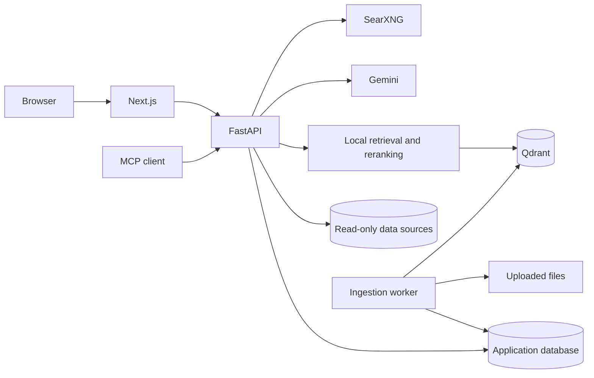

# Architecture

DataMind is a modular monolith with a separate ingestion worker. FastAPI, the worker and the MCP adapter share the Python application modules. Next.js proxies browser API requests to maintain one origin for cookie and CSRF handling.

## Authorization

Users belong to workspaces through memberships. Administrators manage sources; members require explicit grants. Conversations and dashboards remain private to their owners. Every query, evidence lookup, export and saved artifact rechecks workspace, source and version access. A policy epoch interrupts generation when permissions change.

Sessions are opaque tokens stored by digest. Browser mutations require CSRF validation; MCP tools require authenticated bearer sessions. Connection configurations are encrypted using the operator's Fernet key.

## Structured data

SQL is parsed and checked against allowed resources and functions. Execution also uses read-only credentials/transactions, timeouts, row limits and byte budgets. SQLite uses an authorizer and read-only filesystem access. DuckDB disables external access during queries. MongoDB uses a typed, bounded operator/stage allowlist without scripting, writes or cross-collection lookup.

## Document ingestion

Uploads are validated and saved with generated filenames. A database-backed queue claims work using leases. Documents are parsed into blocks, chunked around 1,200 characters with overlap, embedded locally and indexed with source/workspace/version metadata. CSV/XLSX are imported into owned DuckDB files.

Replacement retains source identity and grants while creating a new version. Historical uploaded bytes remain available through permission-checked downloads; restoration creates another version and reprocesses the file. Outdated answer artifacts are denied. A superseded worker cannot publish a previous version as current.

## Retrieval and orchestration

Dense and sparse searches use workspace/source/version filters before rank fusion and cross-encoder reranking. Returned passages carry citation IDs and document metadata. A bounded planner can request up to six validated steps; independent reads can run concurrently, and SQL repair is bounded. Answers stream with citation-existence validation, execution traces and usage records.

Conversation scope is persisted. Historical messages linked to unselected, inaccessible or outdated sources are excluded from model context. Account personalization affects synthesis presentation, not tool permissions.

## Public search

Web is enabled by default but can be disabled per conversation. A conservative classifier builds bounded public queries from the current question only. It never appends history, document passages, catalogs or query output. Eligible public questions can fall back to search when local retrieval returns no evidence. Public snippets are external evidence, not trusted instructions or verified facts.

## Persistence and operations

Compose uses PostgreSQL for application state, persistent named volumes for services and a host-mounted `data/` directory for uploads, local tables and models. Alembic applies explicit migrations before startup. API, worker and migrations share one runtime image. Failed provider calls retain conservative quota reservations when final usage is unavailable.

The current profile is intended for trusted local use. See [SECURITY.md](SECURITY.md) and [DEPLOYMENT.md](DEPLOYMENT.md) for production boundaries.
