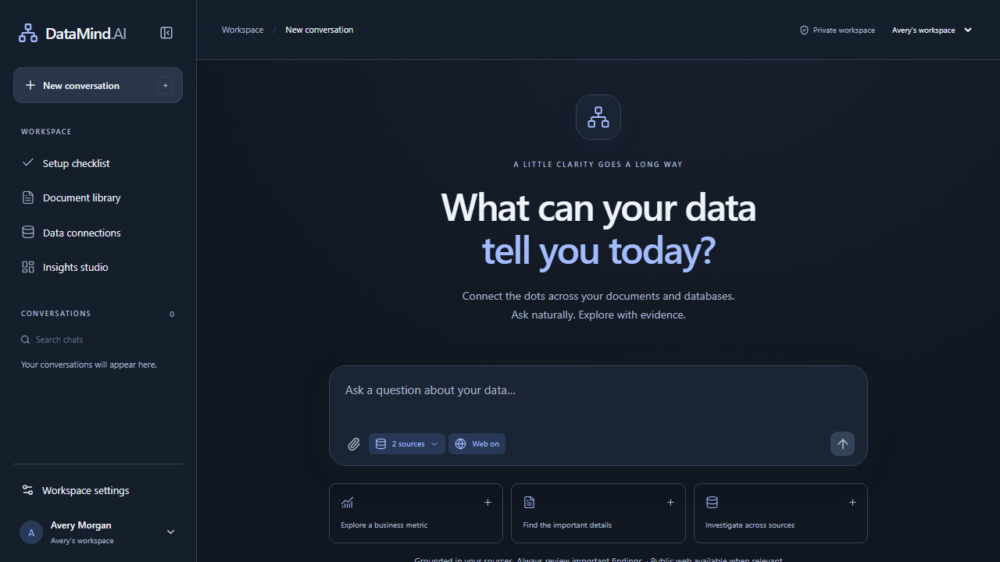

# DataMind.AI

A self-hosted workspace for asking questions across databases, documents and public web sources, with inspectable queries and cited evidence.



## Features

- Read-only PostgreSQL, MySQL, SQLite and MongoDB connections with resource selection and business metric definitions.
- Document ingestion for PDF, DOCX, Markdown, text and JSON; CSV and XLSX become queryable DuckDB tables.
- Local dense and sparse retrieval with rank fusion and cross-encoder reranking, backed by Qdrant.
- Gemini planning and streamed answers with document, query-result and web citations.
- Private conversations, pins, saved source scope, account personalization and reusable dashboards.
- Document processing stages, file replacement, revision downloads and restoration.
- Workspace roles, explicit source grants, encrypted connection credentials and live permission checks.
- Public web search through SearXNG, with automatic routing and a per-conversation off switch.
- An authenticated MCP endpoint exposing ten read-only data and evidence tools.
- Light/dark themes, responsive layouts, a setup checklist and an execution inspector.

The interface screenshot uses fictional demonstration data.

## Stack

| Layer | Technology |
|---|---|
| Web | Next.js, React, TypeScript, ECharts |
| API and worker | Python, FastAPI, SQLAlchemy, Alembic |
| Application state | PostgreSQL in Compose; SQLite for native development |
| Retrieval | Qdrant, FastEmbed, BM25 and local ONNX models |
| Answer generation | Google Gemini Interactions API |
| Public search | SearXNG |
| Local deployment | Docker Compose |

## Quick start

Install Python 3.13, Docker with Compose, and Git. Node.js 22.13+ is required for native frontend development; the container build installs its own Node dependencies.

```bash
git clone https://github.com/aryanatray/datamind-ai.git
cd datamind-ai
python -m venv .venv
```

Activate the environment:

```bash
# macOS / Linux
source .venv/bin/activate
```

```powershell
# Windows PowerShell
.\.venv\Scripts\Activate.ps1
```

Then install and configure:

```bash
python -m pip install -e ".[dev]"
python infrastructure/scripts/setup.py
```

Edit the generated `.env` locally. Set `GEMINI_API_KEY` and select a model available to your account. No API key or runtime configuration is included in this repository. Database inspectors and document ingestion work without a Gemini key; natural-language answers require one and may incur provider charges.

```bash
docker compose up -d --wait postgres mysql mongo qdrant search
python datasets/generate.py
python datasets/load_services.py
docker compose --profile app up -d --build
```

Open **http://localhost:3000**, create an account, and follow **Setup checklist**. Initial document processing may download local embedding and reranking models.

The fixture loader targets only the isolated Compose demo databases. Do not point it at production data.

## Connect the demo sources

Inside the Docker-hosted app, use these settings and the locally generated `DEMO_DB_PASSWORD`:

| Type | Host | Port | Database | Read-only user | Resources |
|---|---|---:|---|---|---|
| PostgreSQL | `postgres` | 5432 | `aster` | `aster_reader` | `public.customers`, `public.orders` |
| MySQL | `mysql` | 3306 | `aster` | `aster_reader` | `invoices` |
| MongoDB | `mongo` | 27017 | `aster` | `aster_reader` | `tickets` |

MongoDB's authentication database is `aster`. For Windows-host databases accessed from Docker, use `host.docker.internal` and add it to the operator-controlled host allowlist. Use genuine read-only accounts.

Click **Test & discover**, select resources, define business metrics and save. Upload files from `datasets/generated/` through **Document library** and wait for **ready**.

Example questions:

- What is C001's total booked revenue? Expected: **$4,620** from PostgreSQL.
- How much is overdue in invoices? Expected: **$4,890** from MySQL.
- How many open tickets have the exact customer ID C001? Expected: **1**.
- What notice period applies to C001's renewal? Expected: **31 days**, with a contract citation.
- For C003, combine booked revenue, overdue invoices and open tickets. Expected: **$5,220**, **$590**, **1**.

Select the relevant sources and inspect **Sources & execution** to verify results. These are synthetic fixtures, not business acceptance evidence.

## Configuration and storage

Copyable variable names and blank credential fields are in [`.env.example`](.env.example). `setup.py` generates local secrets and preserves an existing `.env`.

- Original uploads and DuckDB files: `data/files`.
- Downloaded models: `data/models`.
- Document metadata, jobs, sessions and conversations: the application database.
- Chunk text, vectors and citation metadata: the persistent Qdrant volume.

API, worker and migration jobs share the `datamind-runtime:local` image. The API is published on `127.0.0.1:18000`; the UI on `127.0.0.1:3000`. See [deployment](DEPLOYMENT.md) for services, ports, backups and upgrades.

## Development and validation

```bash
python -m ruff check apps/api tests datasets infrastructure/scripts
python -m ruff format --check apps/api tests datasets infrastructure/scripts
python -m pytest -q
```

```bash
cd apps/web
npm ci
npm run lint
npm run build
npm run typecheck
npm test
```

The current local validation baseline is **118 backend tests**, **3 frontend unit tests** and **7 non-provider browser workflows** passing. See [VALIDATION.md](VALIDATION.md) for scope and limitations. GitHub Actions runs application checks, service integration tests, container builds and dependency audits; the workflow's status is independent of those local results.

## Deployment status

This is a controlled local deployment profile. Public deployment requires verified identity, target TLS, parser resource containment, backup/restore testing and representative load and answer-quality evaluation. A previously observed provider planning HTTP 400 remains under investigation; offline request/schema tests do not establish live API acceptance. Known Pillow advisories also require resolution against FastEmbed's supported dependency range. See [SECURITY.md](SECURITY.md).

## Documentation

- [Architecture](ARCHITECTURE.md)
- [Deployment](DEPLOYMENT.md)
- [Development](DEVELOPMENT.md)
- [Validation](VALIDATION.md)
- [Evaluation](EVALUATION.md)
- [Security](SECURITY.md)
- [Contributing](CONTRIBUTING.md)

## License

[MIT](LICENSE).
